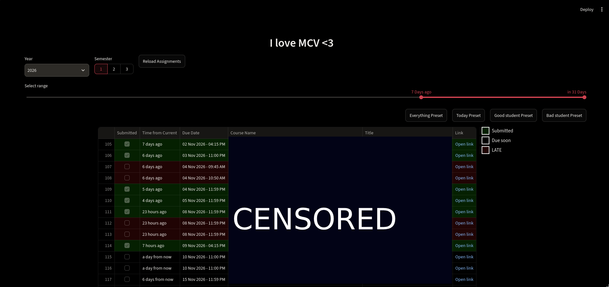

# myCourseVille (assignments) Scraper

## What is this

This is a myCourseVille scraper that currently scrapes all your assignments for you!
I made this cuz mcv doesnt show assignments due in the past (HUGE PROBLEM FOR THE MASTER PROCRASTINATOR KNOWN AS ME) and the notification section is limited to only 7 days of history.
Also this project is like 95% hand-coded and 5% random ai models cuz i wanted to have fun with it!

Is this useful? probably. Did I know there's like 49871234897 identical projects on github when I first made this? NO\
Did I spend my precious time making this instead of vibe coding it? YES

ALSO, u might be able to use ./notes.md somehow\
Anyways, hope this is helpful for someone ;>

## Instructions

```
# pull this repo
# make ur venv

pip install -r requirements.txt
```

```
# put ur mcv credentials in .env_template like this (NO QUOTES)
```

> .env_template\
> ID=1234578\
> PASSWD=iloveapples

```
# rename .env_template to .env

streamlit run streamlit-script.py
```

## Screenshot


the thing
